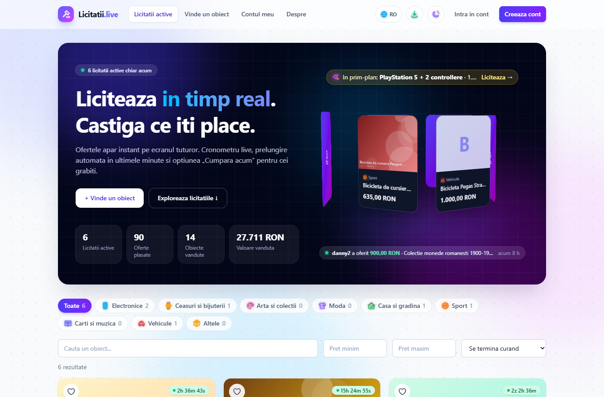
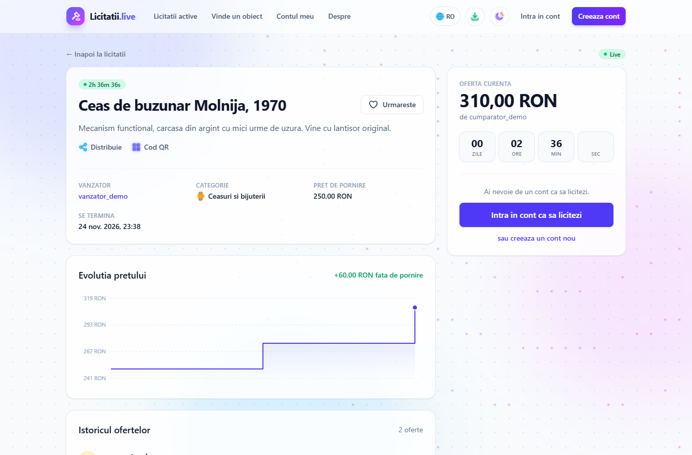
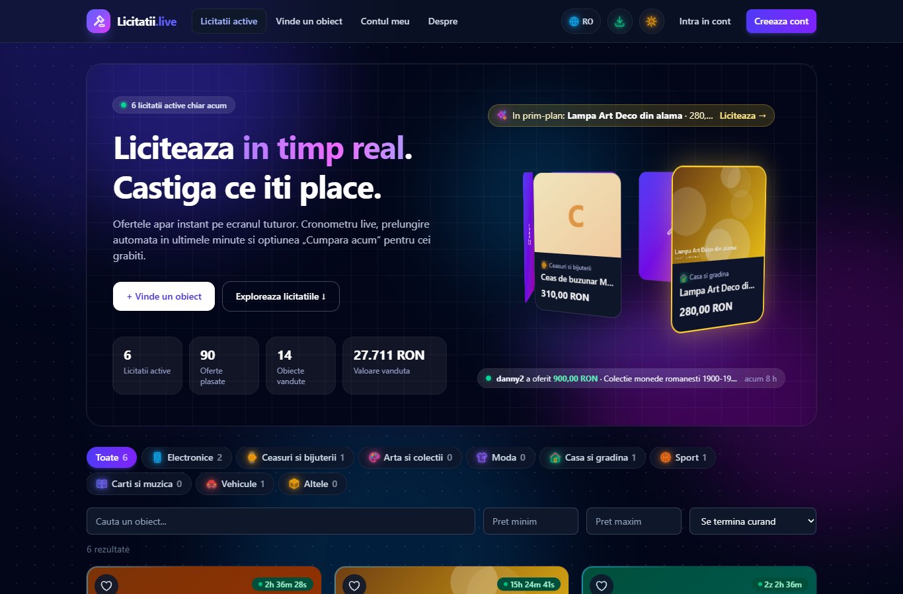
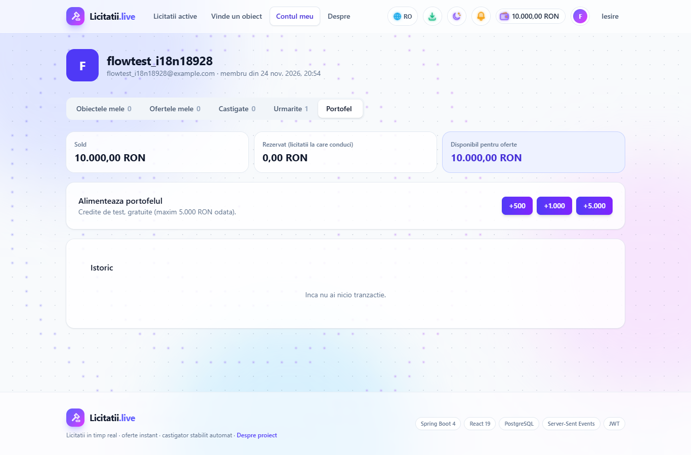
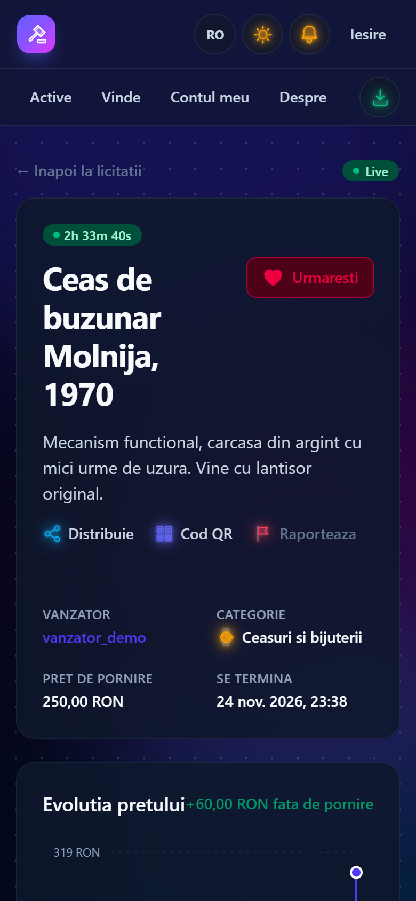
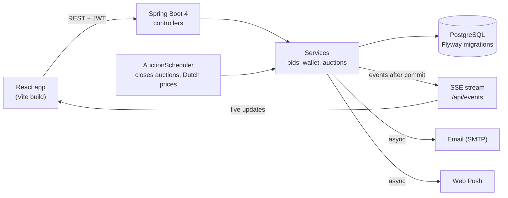

# Licitatii.live: real-time auction platform

[](https://github.com/DannyUreche/auction-engine/actions/workflows/ci.yml)

A full-stack online auction site: bids show up on every screen instantly, auctions close by themselves and
pick the winner, and buyers and sellers get notified by in-app bell, email and browser push.
The interface is in Romanian, with an English toggle.

**Live demo:** https://auction-engine.onrender.com (free hosting, so the first load can take ~1 minute while the server wakes up)



| Item page | Dark mode |
|---|---|
|  |  |

| Wallet | Mobile |
|---|---|
|  |  |

## Features

**Auctions**
- Classic (English) auctions with tiered minimum increments, anti-sniping (a bid in the last 2 minutes extends the auction) and optional "Buy now".
- Dutch auctions: the price drops every minute until someone buys.
- Scheduled auctions that open at a chosen time (watchers are notified when they start).
- Proxy bidding: set a maximum and the server bids for you, only as much as needed.
- Virtual wallet with escrow: bids are limited to the money you have available; the winner pays into escrow and the seller is paid only after the buyer confirms delivery (AWB tracking, disputes settled by an admin, automatic deadlines). Optional card top-ups through Stripe Checkout in test mode.
- Live shows: a seller puts several items on stage one after another, each with a short slot (with a 15 s anti-sniping window that shifts the next lots).
- Verifiable auctions: bids are chained with SHA-256 by a database trigger and re-checked in the browser, which also keeps receipts of your own bids, so the history can't be changed unnoticed.
- Safe under load: every price change locks the item row; a load test with 200 simultaneous bidders (`load-test/`) checks that no bid is lost or doubled.

**Live and social**
- Server-Sent Events: prices, the 3D showcase, charts and the bid ticker update without reloading.
- Notifications in the bell, by email (SMTP) and as browser push (Web Push with VAPID), even when the site is closed.
- Watchlist, recommendations ("You might like"), public seller profiles with ratings, reviews and reputation badges.
- Live auction room: viewer count, public live chat and new bids floating in real time.
- Saved search alerts, seller statistics (views, bids, watchers), county and delivery filters.
- Interactive map of Romania with auctions per county, the auction of the week, a monthly leaderboard with challenges.
- Private offers with counter offers, following sellers, side-by-side comparison, price estimates from similar sales.
- Collections: personal lists of auctions, public ones shareable with a link and shown on the profile.
- "Piata in cifre": public market statistics (median price per category, weekly sales, most contested auctions, a heatmap of bidding hours).
- Price history and selling tips in the sell form, drawn from the listings that sold.
- Public questions and answers on each item, private chat between seller and winner after the sale with a typing indicator and read receipts.
- Sharing with link previews (Open Graph tags rendered by the server) and a QR code.

**Accounts and safety**
- JWT login, optional two-factor authentication (authenticator app), sign-in with Google, email verification, password reset, rate limiting on the auth endpoints.
- AI listing assistant: Claude suggests the name, description, category and starting price from a photo; AI search turns a request in plain words into the search filters.
- Built-in error monitoring: unexpected server errors and JavaScript errors from browsers are grouped in the admin panel.
- Account data export and account deletion (GDPR), and a keep-alive health check for the free hosting.
- Reporting items, AI moderation of new listings, an admin panel with moderation, blocking accounts, an audit log, charts and demo data.

**Interface**
- React 19 + Tailwind CSS v4, animated dot-grid background, CSS 3D carousel, custom neon icon set, dark mode, RO/EN.
- Installable as an app (PWA) with an offline page.
- No chart, animation or 3D libraries: everything is plain SVG, CSS and canvas.

## Architecture



- **Backend:** Java 21, Spring Boot 4 (Web MVC, Security, Data JPA, Mail), PostgreSQL, Flyway, Lombok, springdoc OpenAPI (every endpoint documented in Swagger UI at `/swagger-ui.html`).
- **Frontend:** React 19, React Router, Vite, Tailwind CSS v4 (plain JavaScript).
- **Tests:** about 140 Spring Boot integration tests against a real PostgreSQL, Vitest unit tests for the frontend logic and Playwright browser tests; CI shows the line coverage (JaCoCo, Vitest) in each run summary.
- **CI/CD:** GitHub Actions runs both test suites on every push; Render builds the Docker image and deploys `main`; the database is on Neon.

## Running locally

Requirements: JDK 21+, Node.js 22, Docker.

```bash
docker compose up -d                          # PostgreSQL on port 5433
cp local.properties.example local.properties  # then set jwt.secret (see the file)
./mvnw spring-boot:run                        # API on http://localhost:8080

cd frontend
npm install
npm run dev                                   # UI on http://localhost:5173
```

- API documentation (Swagger UI): http://localhost:8080/swagger-ui.html
- Backend tests: `./mvnw test` (needs the Docker database)
- Frontend unit tests: `cd frontend && npm test` (`npm run test:coverage` for the coverage report)
- Backend coverage report: `./mvnw test -Pcoverage` -> `target/site/jacoco/index.html`
- Browser tests: `cd frontend && npm run test:e2e` (needs the backend running)

Map of Romania: county outlines from [@svg-maps/romania](https://github.com/VictorCazanave/svg-maps) by Popa Ioan Alexandru, licensed [CC BY 4.0](https://creativecommons.org/licenses/by/4.0/).

Optional environment variables: `MAIL_HOST`, `MAIL_PORT`, `MAIL_USERNAME`, `MAIL_PASSWORD`, `MAIL_FROM` (email
and email verification), `GOOGLE_CLIENT_ID` (sign-in with Google), `ANTHROPIC_API_KEY` (AI listing assistant), `ADMIN_USERNAMES` (admin accounts), `APP_BASE_URL`.
Without them the app still runs: emails are only logged, and the Google button is hidden.

**Emails with Brevo (free, 300 emails/day):** create an account at brevo.com, then in *SMTP & API → SMTP* generate an
SMTP key and verify a sender address. Set `MAIL_HOST=smtp-relay.brevo.com`, `MAIL_PORT=587`, `MAIL_USERNAME` (the SMTP
login shown by Brevo), `MAIL_PASSWORD` (the SMTP key) and `MAIL_FROM` (the verified sender). The admin page then shows
"Email: Configurat" and a *send test email* button.
